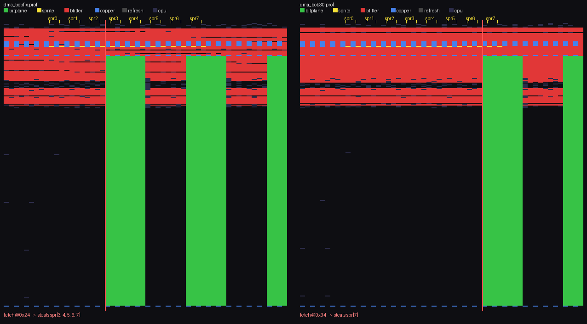
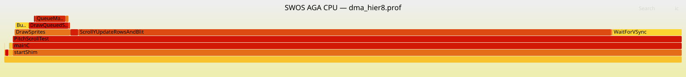

# AmigaScope

**A headless, AI-friendly harness for debugging, instrumenting, and profiling real Amiga
(and SDL) code.**

One command-line pipe — **no IDE, no GUI**:

1. **Debugging (the core).** AmigaScope drives **gdb** against a live Amiga (through the
   [`benbaker76/vscode-amiga-debug`](https://github.com/benbaker76/vscode-amiga-debug)
   cycle-exact **FS-UAE**'s remote stub) *or* a native **SDL/x86** build. The whole debugger
   is **scriptable**, so an AI assistant (Claude Code, etc.) or any tool can read/write
   memory, set breakpoints and watchpoints, inspect registers, single-step, and drive the
   target one command at a time.
2. **Instrumentation.** Observe the live machine, cycle-exact: **DMA raster maps** (which
   channel owns every colour-clock), live **copper** disassembly, and **frontbuffer** capture.
3. **Profiling.** Where the cycles go: **CPU flame graphs** (flat or hierarchical) and
   DMA-contention analysis — what's eating the frame budget.

| Tool | What it does |
|------|--------------|
| **gdb harness** — `gdb_proxy.py` + `amiga_gdb.sh` | **The core.** Launch + attach gdb to a running Amiga (m68k via FS-UAE) *or* the SDL/x86 build, then drive it headlessly: read/write memory, breakpoints, watchpoints, registers, backtraces, `stepi`, `continue`. One command per call, async-halt aware — built for scripts and AI assistants. |
| DMA raster map — `dma_profile.py` | Every colour-clock × scanline, colour-coded by DMA channel; *see* the blitter steal the beam or a fetch clobber a sprite slot. |
| CPU flame graph — `cpu_flamegraph.py` | Where the 68k spends the frame — flat or hierarchical (DWARF unwind), via FlameGraph. |
| Size profiler — `size_profile.py` | Where the *bytes* go — functions / data / references (relocations), with a size flame graph. Static (no running target). |
| Copper disassembler — `copper_disasm.py` | A live copper list decoded (BPLCON0 planes, FMODE, DDF/DIW, fine-scroll, colours). |
| Frontbuffer capture — `fb_capture.py` | The displayed bitmap decoded straight from chip RAM. |

It grew out of debugging AGA rendering on a Sensible World of Soccer port, but the harness
is generic Amiga (+ SDL) debugging.

## Debugging — the core

Bring the harness up, then talk to the target through `gdb_proxy.py cmd` (any gdb command works):

```sh
./amiga_gdb.sh up                                # launch FS-UAE, attach gdb, wait for entry
gp() { python3 gdb_proxy.py "$@"; }

gp health                                        # OK stopped PC=0x...
gp cmd "print g_someGlobal"                       # read a symbol
gp cmd "x/16xw 0x219b10"                          # read 16 words of memory
gp cmd "set variable g_flag = 1"                  # write a variable
gp cmd "set {int}0x2001a4 = 0xdead"               # write raw memory
gp cmd "break SomeFunc"                           # breakpoint
gp cmd "watch g_counter"                          # watchpoint
gp cmd "continue"; gp waitstop                    # run, then block until the halt
gp cmd "backtrace"; gp cmd "info registers"       # inspect on stop
```

The **same** harness with `--mode sdl` drives the native Linux/SDL build under `/usr/bin/gdb`
(no FS-UAE), so the identical read/write-memory / breakpoint recipes work on the SDL port too.

**Why headless matters:** an AI assistant can run the *whole* debug loop itself — set a
watchpoint, continue, read the faulting struct, correlate with source — with no human clicking
in an IDE. That is the point of AmigaScope; the profilers below are a bonus built on the same pipe.

## MCP server (AI-native frontend)

Everything above is also exposed over the **Model Context Protocol**, so an MCP client
(Claude Code, Claude Desktop, …) drives the debugger through **typed tools** instead of
constructing shell commands — structured results, and DMA maps / frontbuffer captures come
back as inline images. Same engine (the CLI); MCP is just the AI-facing face.

```sh
pip install -r requirements.txt   # Pillow + mcp
python3 amigascope_mcp.py         # stdio transport
```

**Registration:** see **[docs/MCP.md](docs/MCP.md)** for Claude Code / Claude Desktop setup
(there's a ready-to-edit `.mcp.json.example`). It exposes ~24 tools — `read_memory` / `write_memory` / `read_symbol` / `write_symbol`,
`set_breakpoint` / `set_watchpoint` / `continue_and_wait` / `step_instruction` /
`backtrace` / `registers` / `disassemble` / `gdb_raw`, plus `dma_profile` / `dma_map` /
`cpu_flamegraph` / `size_profile` / `disasm_copper` / `capture_frontbuffer` and
`harness_up` / `harness_down`. Debugging tools need the harness up; profiling tools need
the cycle-exact FS-UAE build.

## Instrumentation & profiling

Once you can drive the target headlessly, the same pipe feeds cycle-exact instrumentation
and profiling. Screenshots tell you *what* went wrong; these tell you *why* — *is the blitter running on
display lines? where does the bitplane fetch start relative to the sprite DMA slots? what
function is eating the frame budget?* — with **measurement, not guesswork.**




## Also in the box

- `shot.sh` — settle + capture a composited screenshot at a target state.
- `analyze_pc32.py` / `fix_hunk_relocs.py` — inspect and repair `R_68K_PC32` relocations
  from `elf2hunk`, so the ELF you debug matches what actually runs on the Amiga.

## Requirements

- **The [`benbaker76/vscode-amiga-debug`](https://github.com/benbaker76/vscode-amiga-debug)
  extension** — kept in sync with our custom FS-UAE. It bundles both the cycle-exact
  **FS-UAE** build (the `monitor profile` DMA recorder AmigaScope drives) and the
  **`m68k-amiga-elf` toolchain** (`objdump`, used for symbol/DWARF resolution). Point the
  harness at the bundled FS-UAE with `FSUAE_BIN`; a stock FS-UAE has no DMA recorder.
- FS-UAE source alone (if building it yourself):
  [`benbaker76/fs-uae` @ `remote_debugger_barto`](https://github.com/benbaker76/fs-uae/tree/remote_debugger_barto).
- **Python 3.6+** with **Pillow** (`pip install pillow`) for the PNG raster maps.
- **`mcp`** (`pip install mcp`) — only if you use the MCP server (`amigascope_mcp.py`);
  the CLI needs nothing extra.
- **FlameGraph** — bundled as a git **submodule** (`third_party/FlameGraph`, from
  [`benbaker76/FlameGraph`](https://github.com/benbaker76/FlameGraph)); no extra install if
  you clone recursively. Override the renderer with `$FLAMEGRAPH_PY` if you prefer.
- A gdb-debuggable Amiga ELF with symbols (and `.debug_frame` for hierarchical stacks) —
  set `AMIGASCOPE_ELF`.

## Install

```sh
git clone --recursive git@github.com:benbaker76/AmigaScope.git   # pulls FlameGraph too
# already cloned? grab the submodule:
git submodule update --init --recursive
pip install -r requirements.txt      # Pillow (CLI) + mcp (MCP server)
```

## Quick start

```sh
# 1. bring up the harness (launches FS-UAE, attaches gdb, waits for your entry trigger)
./amiga_gdb.sh up

# 2. capture + analyse a DMA profile
python3 dma_profile.py 4                    # 4 frames: contention + per-blit spans
python3 dma_profile.py map  out.prof        # -> colour-coded DMA raster-map PNGs
python3 dma_profile.py parse out.prof       # fetch-vs-sprite-slot steal report

# 3. CPU flame graph (from the same .prof)
python3 cpu_flamegraph.py top out.prof            # top functions by cycles
python3 cpu_flamegraph.py capture 8 cpu.prof      # capture WITH unwind (hierarchical)
python3 cpu_flamegraph.py svg cpu.prof flame.svg  # -> interactive flame graph

# 4. peek at the copper list / frontbuffer
python3 copper_disasm.py
python3 fb_capture.py out.png
```

## How it works

`monitor profile <N> <unwind> <out>` runs FS-UAE's cycle-exact recorder for N frames and
writes a binary blob: a `227×313` DMA-record grid per frame **plus** the CPU sample
stream. AmigaScope parses that blob (format from
[`vscode-amiga-debug`](https://github.com/benbaker76/vscode-amiga-debug)'s `profile.ts`)
and renders it. Hierarchical stacks come from a DWARF `.debug_frame` unwind
table that AmigaScope generates and hands back to FS-UAE.

**Gotchas worth knowing** (documented in `docs/`):
- `monitor profile` replies instantly then writes the file *asynchronously* — poll for it.
- Profile with the target **stopped and no breakpoints set** (a breakpoint hit mid-profile
  stalls the frame).
- Cycle-exact frames are slow (~15–25 s wall-clock each); heavy-DMA frames slower still.

## Configuration

Some defaults are still tuned for the original project (ELF path, `.text` base, display
window). Override via environment:

- `SWOS_ELF` / `M68K_OBJDUMP` / `FLAMEGRAPH_PY` — tool paths.
- `FSUAE_BIN` / `KICKSTART` / `DH0` — harness launch (see `amiga_gdb.sh`).

*(Generalizing these into first-class CLI flags is the top open item — see `TODO`.)*

## Credits

- **[benbaker76/vscode-amiga-debug](https://github.com/benbaker76/vscode-amiga-debug)** —
  the maintained extension + custom cycle-exact FS-UAE this drives.
- **Bartman/Abyss** — the original amiga-debug extension + WinUAE cycle-exact recorder port
  it's based on.
- **Brendan Gregg** — FlameGraph.
- **FS-UAE** / **WinUAE** — the emulator and its DMA debugger.

## License

[MIT](LICENSE). The bundled **FlameGraph** submodule keeps its own upstream license
(`third_party/FlameGraph`).
